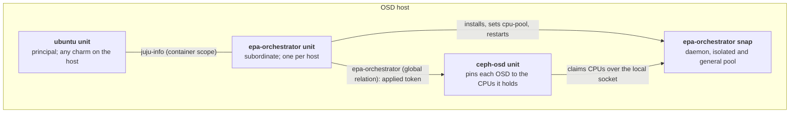

# EPA orchestrator charm: CPU pool configuration and ceph-osd relation

## Abstract

The epa-orchestrator charm becomes the single owner of the EPA orchestrator
snap on a host, including its general CPU pool, and tells related charms when
that snap is ready to use. Today it only installs the snap, and only next to
`sunbeam-machine`.

This spec adds four things to the charm:

- a `juju-info` endpoint, so the subordinate can be placed on any host, for
  example next to `ubuntu` or `ceph-osd`;
- a `cpu-pool` configuration option that sets the snap's general CPU pool;
- a provided `epa-orchestrator` endpoint, a regular (global) relation that
  consumers such as ceph-osd integrate with;
- a notification on that relation each time the snap or its configuration has
  been applied on a unit.

## Rationale

The EPA orchestrator is one daemon per host that several workloads share. It
records which logical CPUs each client holds: Nova and OVS-DPDK claim from its
`isolated` pool, ceph-osd from its `general` pool. A shared host service needs
one owner, and its pool has to be sized for all clients together, which no
single client can do.

The epa-orchestrator charm is that owner, but it falls short in three ways:

- **It only deploys with Sunbeam.** Its single container relation is
  `sunbeam-machine`, and that relation is mandatory.
- **It cannot configure a pool.** The snap's `cpu-pool` setting has no charm
  option, and the charm never restarts the daemon, which a pool change needs.
- **Consumers cannot tell when it is ready.** Juju gives a consumer unit no
  event when the snap on its own host becomes usable or its pool changes.

## Specification

### Deployment model

The charm stays a subordinate and runs as exactly one unit per host. It is
attached to one principal on that host and integrated with its consumers over
a regular relation:

```
juju deploy ubuntu --to 0,1,2
juju deploy epa-orchestrator --config cpu-pool=2-7
juju integrate epa-orchestrator:juju-info ubuntu:juju-info
juju integrate ceph-osd:epa-orchestrator epa-orchestrator:epa-orchestrator
```

Every host that runs OSDs then looks like this:



The relation itself is global, so a ceph-osd unit also hears from the EPA
units of other hosts. It relies on its local socket to know what applies to
it.

Any principal on the host will do, including ceph-osd itself. Relating the
charm to two principals on the same host creates two units that manage one
snap, which is not supported.

### Endpoints

| Endpoint | Role | Interface | Scope | Change |
| --- | --- | --- | --- | --- |
| `juju-info` | requires | `juju-info` | container | New. |
| `sunbeam-machine` | requires | `sunbeam-machine` | container | No longer mandatory. |
| `epa-orchestrator` | provides | `epa-orchestrator` | global | New. |
| `tracing` | requires | `tracing` | global | Unchanged. |

The charm treats `juju-info` and `sunbeam-machine` as equivalent ways of being
placed on a host and no longer blocks when `sunbeam-machine` is absent. A
subordinate unit only exists while one of the two relations does, so there is
no extra readiness check.

### Configuration

| Option | Type | Default | Change |
| --- | --- | --- | --- |
| `cpu-pool` | string | empty | New. CPUs of the snap's `general` pool as a list of IDs and inclusive ranges, for example `2-7,12-15`. Empty means no general pool. |
| `snap-channel` | string | `2025.1/edge` | The default has to move to a channel whose snap advertises `cpu-pools` and `non-preemptive-allocations`. |
| `snap-name` | string | `epa-orchestrator` | Unchanged. |

`cpu-pool` applies to every unit of the application. Hosts with different CPU
layouts need separate applications of the charm, each attached to a principal
that only runs on hosts of that layout.

The charm passes the value to the snap as it is and does not size, grow or
validate the pool. The operator chooses CPUs that cover all general-pool
clients on each NUMA node they use, and leaves CPUs for the host. The isolated
pool is not configurable: it always comes from the kernel's isolated CPU set.

### Applying the snap and the pool

The charm brings the snap to the configured state on `install`,
`upgrade-charm`, `config-changed`, the `refresh-snap` action, and when the
`epa-orchestrator` relation is created or joined. Each run does the following,
in order:

1. Install the snap from `snap-channel` and hold it, as today.
2. Compare `cpu-pool` with the snap's current `cpu-pool` setting. If they
   differ, set it (`snap set epa-orchestrator cpu-pool=<value>`) or unset it
   when the option is empty.
3. Restart `epa-orchestrator.daemon` if step 2 changed the setting. Both pools
   are fixed when the daemon starts.
4. Wait, for a bounded time, until the daemon answers a `list_allocations`
   request on `/var/snap/epa-orchestrator/current/data/epa.sock`.
5. If `cpu-pool` is set, check that the daemon advertises `cpu-pools` and that
   a `list_allocations` request with `pool: general` reports the configured
   CPUs.
6. Publish the notification described under the relation below.

A run that changes nothing restarts nothing and publishes nothing new.

The snap's configure hook validates a new pool and can reject it. It refuses
CPUs that do not exist, CPUs that overlap the isolated set, a pool that
excludes CPUs still claimed by a client, and removal of a pool that still has
claims. On a rejection the unit blocks with the snap's message, the previous
pool stays in effect, the daemon is not restarted and nothing is published. A
pool can therefore only shrink below current claims after the clients have
released them.

Restarting the daemon does not disturb running workloads. The snap only keeps
records; it never applies CPU affinity, and claims survive the restart.
Requests fail while the daemon is down, and consumers are expected to retry
for a short time.

The charm currently skips all service handling because the snap used to have
no services. It has to drop that assumption for the daemon restart in step 3.

### The `epa-orchestrator` relation

The interface carries one fact: that the snap on a unit's host has been
applied and answers. Everything else a consumer needs, it reads from the
daemon on its own host.

| Side | Writes | Reads |
| --- | --- | --- |
| Provider (this charm) | Unit data, key `applied`: an opaque token. | Nothing. |
| Requirer (ceph-osd and others) | Nothing. | Nothing; only the change event matters. |

Rules for the `applied` token:

- It is written only after steps 1 to 5 succeeded on that unit.
- It changes when the installed snap revision changes, when the applied
  `cpu-pool` changes, and when the charm finds the daemon answering again
  after it had found it down.
- It does not change otherwise. The relation is global, so one change on one
  EPA unit runs a hook on every unit of every related application.
- Consumers must not parse it. A digest of the snap revision, the applied pool
  and a recovery counter is a suitable value.

The charm does not touch the snap, the pool or any claim when the relation is
removed, and it does not remove the snap when the unit is removed. Claims
belong to the consumers that made them.

A consumer cannot tell from the relation whether an EPA unit is on its own
host. It must probe the local socket on every relation event and treat an
unreachable daemon as "not ready yet". ceph-osd does this and ignores events
that leave its local daemon's features and pool unchanged.

### Unit status

| Situation | Status | Message |
| --- | --- | --- |
| Snap applied, daemon answers | active | empty, as today |
| Snap not installed | blocked | `epa-orchestrator snap not installed` (existing) |
| Daemon not running | blocked | `epa-orchestrator service down` (existing) |
| Snap rejected the pool | blocked | `cpu-pool rejected: <the snap's reason>` |
| `cpu-pool` set, snap lacks `cpu-pools` | blocked | `snap does not support CPU pools; change snap-channel` |
| Daemon does not answer after a restart | blocked | `epa-orchestrator daemon not answering` |

The active message stays empty because the Sunbeam functional tests match on
it. The applied pool is visible in the charm configuration and through the
snap.

`update-status` keeps its health check. When it finds the daemon answering
again after a failure it changes the `applied` token, so that consumers that
were waiting retry.

### Compatibility and upgrade

- **Sunbeam deployments** see no change. `cpu-pool` is empty by default, so an
  upgrade sets nothing and restarts nothing, and the new endpoint stays
  unrelated.
- **Isolated-pool clients** are unaffected by a general pool. Requests without
  a `pool` selector keep using the isolated pool.
- **ceph-osd** needs no migration. No released ceph-osd charm installs or
  configures the snap itself.
- **Snap version.** Pool support is in the snap's `2026.1/edge`, `2026.1/beta`
  and `2026.2/edge` channels (as of 2026-11-18), and in no stable channel. The
  charm's default channel, `2025.1/edge`, does not have it; there a non-empty
  `cpu-pool` blocks the unit as described above.

### Testing

- **Unit tests** (`ops.testing` scenarios): a pool is set, changed, unset and
  left unchanged; the snap rejects a pool; the token is written only after a
  successful run and stays the same across runs that change nothing; a
  deployment with only `juju-info` reaches active.
- **Functional test** in the machine bundle: the charm on `ubuntu` with a
  pool, checked through `snap get` and a `list_allocations` request for the
  general pool.
- **Acceptance with ceph-osd.** The ceph-osd resource-profile suite deploys a
  small stand-in charm that implements this contract. Swapping the real charm
  in for the stand-in, with the suite passing unchanged, is the acceptance
  test for this spec.

### Open issues

- **Snap channel.** Which channel becomes the charm's default `snap-channel`?
  Pool support is only published to edge and beta channels so far.
- **Hosts with different CPU layouts.** Suggest one application per hardware
  class, is that acceptable?
- **Two units on one host.** Is documenting the one-principal rule enough, or
  should a second unit detect the first and block?
- **Richer relation data.** Should the provider also publish its hostname,
  pool and features, for consumers that cannot probe the socket? ceph-osd does
  not need it.
- **Requirer library.** Should the interface ship as a charm library for `ops`
  consumers? ceph-osd is a hooks-based charm and uses none.
- **Unit removal with live claims.** Should removing the subordinate warn or
  refuse while the general pool has claims?

## Further Information

### Out of scope

- Sizing the general pool automatically.
- Kernel CPU isolation. A general pool is accounting only; nothing keeps other
  host processes off its CPUs.
- Changes to isolated-pool clients such as Nova and OVS-DPDK.

### Alternatives considered

| Alternative | Why not |
| --- | --- |
| ceph-osd installs and configures the snap | Two owners of one snap on shared hosts; pool sizing without knowledge of other clients. |
| Container relation from the EPA charm to each consumer | One subordinate unit per consumer on the same host, all managing one snap. |
| Consumers poll the socket in `update-status` | Makes a periodic hook allocate CPUs and restart OSDs. |
| Host identity and pool in relation data instead of a local probe | The socket is the source of truth; relation data can lag behind it or describe another host. |

### References

- [EPA orchestrator snap](https://github.com/canonical/snap-epa-orchestrator):
  socket API, pools and the `cpu-pool` setting.
- [epa-orchestrator charm](https://opendev.org/openstack/sunbeam-charms/src/branch/main/charms/epa-orchestrator):
  the charm this spec extends.
- ceph-osd charm, in [ceph-charms](https://github.com/canonical/ceph-charms):
  the consumer side is implemented but not yet proposed. Its
  `RESOURCE-PROFILES.md` describes the consumer's half of this contract, and
  `tests/resource-profiles/epa-orchestrator-stub` is a minimal working
  implementation of the provider's half.
